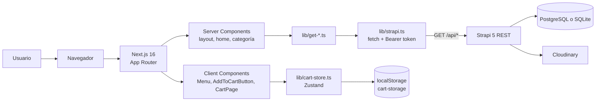
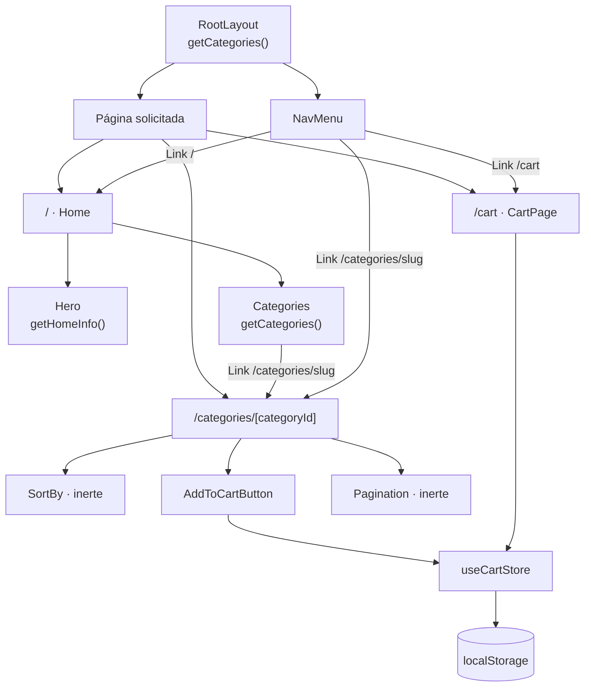
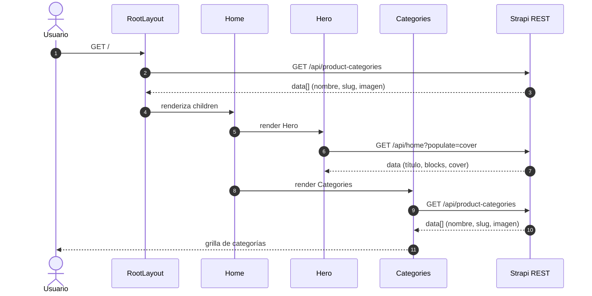
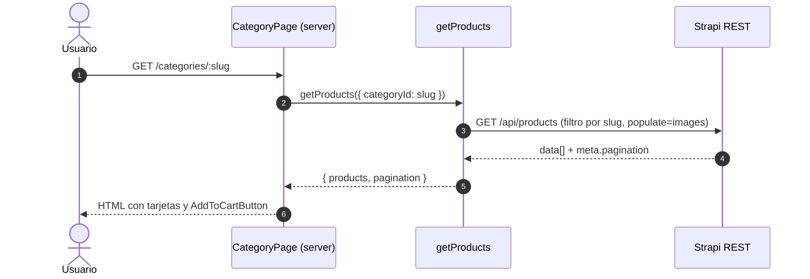
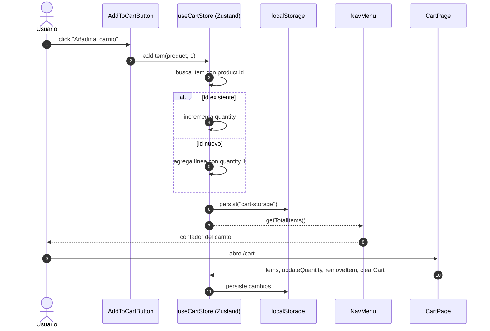
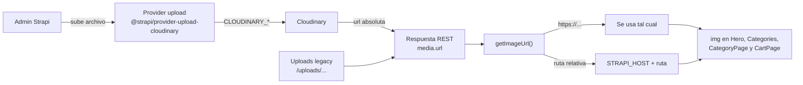
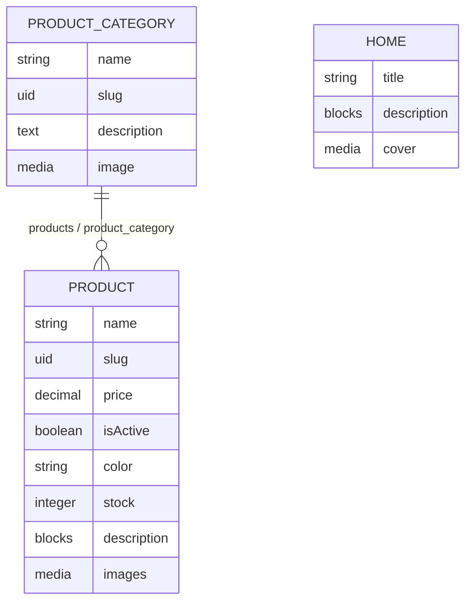
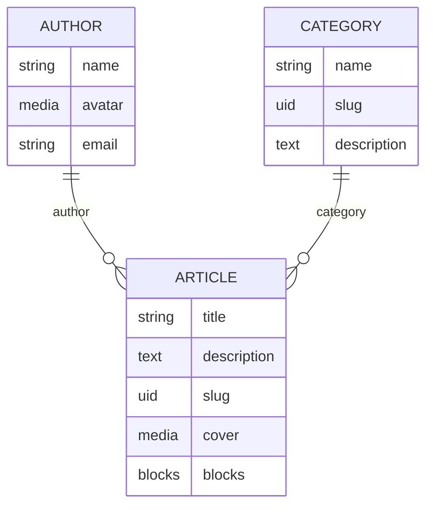

# Arquitectura

> Basado en el código y la configuración actuales. Se distingue lo confirmado en el repositorio de lo que no puede verificarse sin ejecutar servicios o inspeccionar la base de datos. Los diagramas Mermaid se derivan de relaciones presentes en el código.

## 1. Vista de conjunto



- Frontend y backend son procesos separados: Next.js en el puerto 3000 y Strapi en el 8888 (default del código).
- El frontend no usa el SDK de Strapi ni GraphQL: solo `fetch` contra REST.
- El estado del carrito vive en el navegador; no hay sesión de cliente ni persistencia del carrito en backend.
- Cloudinary solo interviene en la subida de media desde Strapi; el frontend consume URLs ya resueltas.

## 2. Capas y responsabilidades

| Capa | Ubicación | Responsabilidad |
| --- | --- | --- |
| Rutas / composición | `web/app/` | Definir URLs, layouts, metadata y componer componentes. |
| Presentación | `web/components/` | UI reusable: navegación, hero, categorías, botón de carrito, sort y paginación. |
| Acceso a datos | `web/lib/strapi.ts`, `web/lib/get-*.ts` | Construir consultas REST, mapear respuestas y resolver URLs de imágenes. |
| Estado de cliente | `web/lib/cart-store.ts` | Carrito Zustand persistido en `localStorage`. |
| API | `backend/src/api/` | Content types, controladores, rutas y servicios de Strapi. |
| Configuración de plataforma | `backend/config/` | Base de datos, plugins, middlewares, seguridad y panel. |
| Administración | `backend/src/admin/app.ts` + panel Strapi | Configuración del admin; gestión de contenido y tokens. |
| Media | `backend/config/plugins.ts`, `web/lib/image-url.ts` | Subida a Cloudinary y resolución de URLs absolutas/relativas. |
| CI | `.github/workflows/ci.yml` | Compilación de ambas apps y verificación no bloqueante de lint/tipos. |

## 3. Flujo de arranque

### Backend

1. `pnpm develop` ejecuta `strapi develop` (`backend/package.json`).
2. Strapi carga `config/server.ts`, `config/database.ts`, `config/admin.ts`, `config/api.ts`, `config/middlewares.ts` y `config/plugins.ts`.
3. Elige el cliente de base de datos según `DATABASE_CLIENT` (default `sqlite`; el `.env` local actual declara `postgres`).
4. Registra los content types de `src/api/`, los componentes de `src/components/shared/` y el plugin de upload con Cloudinary.
5. Expone el panel en `/admin` y la API REST en `/api/*`; el puerto por defecto es 8888.

### Frontend

1. `pnpm exec next dev` arranca Next.js en el puerto 3000. El script `pnpm dev` **no** funciona porque apunta a `nex dev`.
2. `app/layout.tsx` se ejecuta como Server Component async: llama a `getCategories()` y renderiza `NavMenu` con las categorías.
3. La página solicitada se renderiza debajo del layout.

## 4. Flujo de navegación



Confirmado:

- Solo existen tres rutas: `/`, `/cart` y `/categories/[categoryId]`.
- El parámetro `categoryId` es el **slug** de `product-category`, no un id numérico.
- No hay página de detalle de producto; las tarjetas enlazan a `#`.
- El layout se ejecuta en cada request y consulta categorías para el menú.

## 5. Comunicación Next.js ↔ Strapi

### Cliente HTTP

`web/lib/strapi.ts`:

```ts
fetch(`${STRAPI_HOST}/api/${url}`, {
  headers: { Authorization: `Bearer ${STRAPI_TOKEN}` }
}).then(res => res.json())
```

Confirmado:

- `STRAPI_HOST` y `STRAPI_TOKEN` se leen de `process.env` en el servidor.
- No hay variables `NEXT_PUBLIC_*`; el token nunca llega al navegador.
- No se comprueba `res.ok` ni `status`; una respuesta 4xx/5xx se parsea como JSON y se trata como datos.
- No hay opciones explícitas de `cache`/`next.revalidate`; el comportamiento depende del default de Next 16.

### Endpoints consumidos

| Consumidor | Consulta | Endpoint resultante |
| --- | --- | --- |
| `getCategories` | `product-categories?fields[0]=name&fields[1]=slug&fields[2]=description&populate[image][fields][0]=url` | `GET /api/product-categories` |
| `getProducts` | `products?filters[product_category][slug][$contains]=<slug>&populate=images` | `GET /api/products` |
| `getHomeInfo` | `home?populate=cover` | `GET /api/home` |

El código asume la respuesta aplanada de Strapi 5 (`product.name`, `category.slug`, `res.data`), no el formato `data[].attributes` de v4.

### Manejo de errores actual

- `getCategories`: si no hay `data`, registra `console.error` y devuelve `[]`.
- `getProducts`: si no hay `data`, devuelve `{ products: [], pagination: null }`; además hace `console.log(data)`.
- `getHomeInfo`: si no hay `data`, devuelve textos por defecto e `image: null`.
- No hay estados de carga, reintentos, timeouts ni mensajes de error de UI.

## 6. Flujo de productos y categorías

### 6.1 Home (`/`)



Consecuencia confirmada: en la home se ejecutan **dos** peticiones equivalentes de categorías (layout y `Categories`), sin deduplicación explícita en el código. React `cache()` o pasar las categorías desde el layout podrían evitarlo, pero no está implementado.

### 6.2 Categoría (`/categories/[categoryId]`)



Observaciones confirmadas:

- El filtro usa `$contains`, no igualdad exacta de slug.
- No se envían parámetros de paginación; Strapi aplica su default de 25 y devuelve `meta.pagination`.
- `getProducts` no devuelve `id`, pero la página pasa `product.id` al botón del carrito.
- `Pagination` no acepta la prop `pagination` y sus botones no hacen nada.
- `SortBy` no tiene manejadores ni props.
- `description`, `color`, `stock` e `isActive` del producto no se usan en la UI.

## 7. Carrito y gestión de estado



Forma del estado (`lib/cart-store.ts`):

```ts
CartItem = {
  id: string
  slug: string
  name: string
  price: number
  image: string
  quantity: number
}
```

Confirmado:

- `addItem` identifica líneas por `id`; `removeItem` y `updateQuantity` también.
- `persist` usa la clave `cart-storage` y no declara `version`/`migrate`.
- `NavMenu` usa un flag `mounted` para evitar el mismatch de hidratación del contador.
- No hay checkout, creación de orden, reserva de stock ni llamada al backend.

Riesgo confirmado: como `product.id` llega `undefined`, `addItem` busca existentes por `undefined` y puede fusionar productos distintos en una sola línea. Además, `key={item.id}` en `/cart` queda `undefined` para todos los ítems.

## 8. Gestión de imágenes y Cloudinary



1. Strapi sube archivos nuevos mediante el provider `cloudinary` (`config/plugins.ts`), usando `CLOUDINARY_NAME`, `CLOUDINARY_KEY` y `CLOUDINARY_SECRET`.
2. Strapi devuelve la URL del media. Si es absoluta (Cloudinary), `getImageUrl` la deja igual; si es relativa (`/uploads/...`, imágenes legacy), le prefija `STRAPI_HOST`.
3. El frontend renderiza con `` en `Hero`, `Categories`, `CategoryPage` y `CartPage`.
4. `next.config.ts` solo autoriza `res.cloudinary.com` para `next/image`; el catálogo no usa `next/image`.
5. Las imágenes antiguas siguen en `backend/public/uploads/` y las del seed en `backend/data/uploads/`.
6. El upload deniega SVG y ejecutables y aplica listas de tipos permitidos/denegados.

Consecuencia: `next/image` no puede usarse con las rutas relativas de Render sin agregar ese host a `remotePatterns`.

## 9. Autenticación y permisos

Confirmado en el repo:

- El panel de Strapi usa autenticación de administrador con `ADMIN_JWT_SECRET`, `API_TOKEN_SALT`, `TRANSFER_TOKEN_SALT` y `ENCRYPTION_KEY`.
- `users-permissions` está instalado y configurado con JWT refresh y cookie httpOnly, pero no hay controladores, rutas, pantallas ni lógica de registro/login para clientes.
- El frontend se autentica contra la API con un token Bearer de larga duración guardado en `web/.env.local` (server-side).
- No hay login, sesión de usuario, roles de cliente ni protección de rutas en Next.js.

No verificable desde el repositorio:

- Alcance y permisos exactos del API token (se administran en el panel/DB).
- Permisos del rol público para `product`, `product-category` y `home` (se guardan en base de datos). El seed solo asigna permisos públicos a los tipos de blog.
- Configuración efectiva de CORS (el middleware `strapi::cors` no tiene opciones explícitas).

## 10. Modelo de contenido y relaciones



`home` es un single type sin relaciones. `product` y `product-category` usan draft/publish e i18n.

Template de blog (no usado por la tienda):



`about` (single type) usa una dynamic zone con `media`, `quote`, `rich-text` y `slider`. `global` (single type) usa `defaultSeo` del componente `shared.seo`.

`product-category` y `category` son tipos distintos. El primero alimenta la tienda; el segundo pertenece al template de blog.

## 11. Configuración de datos y media

- `config/database.ts` soporta `mysql`, `postgres` y `sqlite`.
- SQLite usa `DATABASE_FILENAME` (default `.tmp/data.db`).
- PostgreSQL usa `DATABASE_URL` o `DATABASE_HOST`/`PORT`/`NAME`/`USERNAME`/`PASSWORD`, con SSL opcional.
- El `.env` local actual declara `DATABASE_CLIENT=postgres`; el default del código sigue siendo SQLite.
- No hay migraciones propias: Strapi gestiona el esquema.
- Los tipos generados (`backend/types/generated/`) están versionados y deben regenerarse al cambiar content types.

## 12. Build, CI y operación

Confirmado en `.github/workflows/ci.yml`:

- Se ejecuta en `push`/`pull_request` a `main`.
- Usa Node 24 y pnpm 10 (aunque `web/package.json` declara pnpm 12.3.4).
- Instala con `--frozen-lockfile`.
- Compila `backend` y luego `web`.
- Antes del build de `web`, hace hasta 10 peticiones a `$STRAPI_HOST/_health` cada 10 s para despertar Render; si no responde, falla.
- `pnpm lint` y `pnpm exec tsc --noEmit` se ejecutan con `continue-on-error: true`.
- Sube `web/.next` como artefacto.
- No hay paso de despliegue ni publicación; el CI no despliega el frontend.

`next.config.ts` ignora errores de TypeScript durante el build, por lo que un build exitoso no garantiza tipos correctos.

## 13. Confirmado vs. hipótesis

| Afirmación | Estado |
| --- | --- |
| Next.js consume Strapi por REST con un Bearer token server-side | Confirmado |
| El carrito persiste solo en `localStorage` | Confirmado |
| Cloudinary es el provider de upload configurado | Confirmado |
| Strapi 5 devuelve la respuesta aplanada | Confirmado por el código que consume `data[].name`, no por ejecución |
| El rol público puede leer productos/categorías | No verificable: permisos en DB |
| El token tiene permisos totales | No verificable: se administra en Strapi |
| El frontend se despliega en Vercel | No hay configuración en el repo |
| Existe checkout/órdenes | No: no hay código |
| Hay tests automatizados | No: no hay framework ni scripts |
| `categoryId` es un id numérico | Falso: es el slug |
| Existe página de detalle de producto | Falso: no hay ruta |
